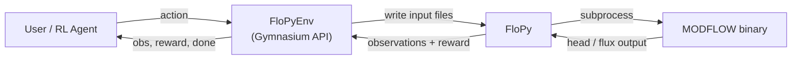
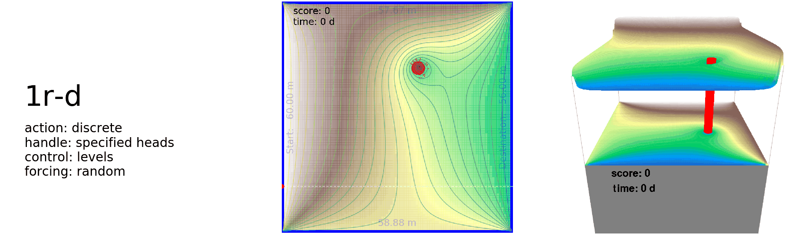
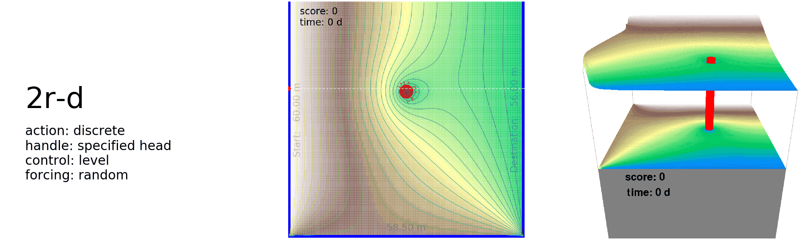
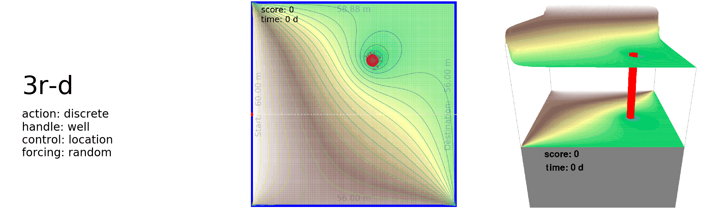
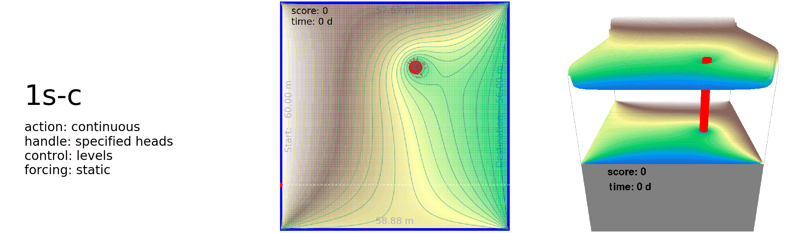
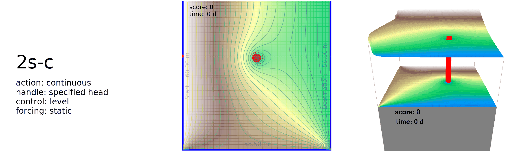
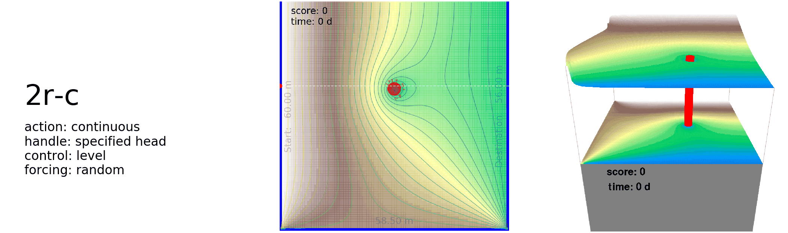
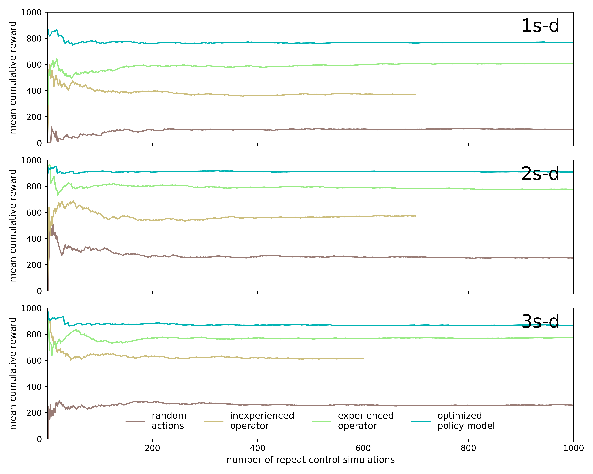
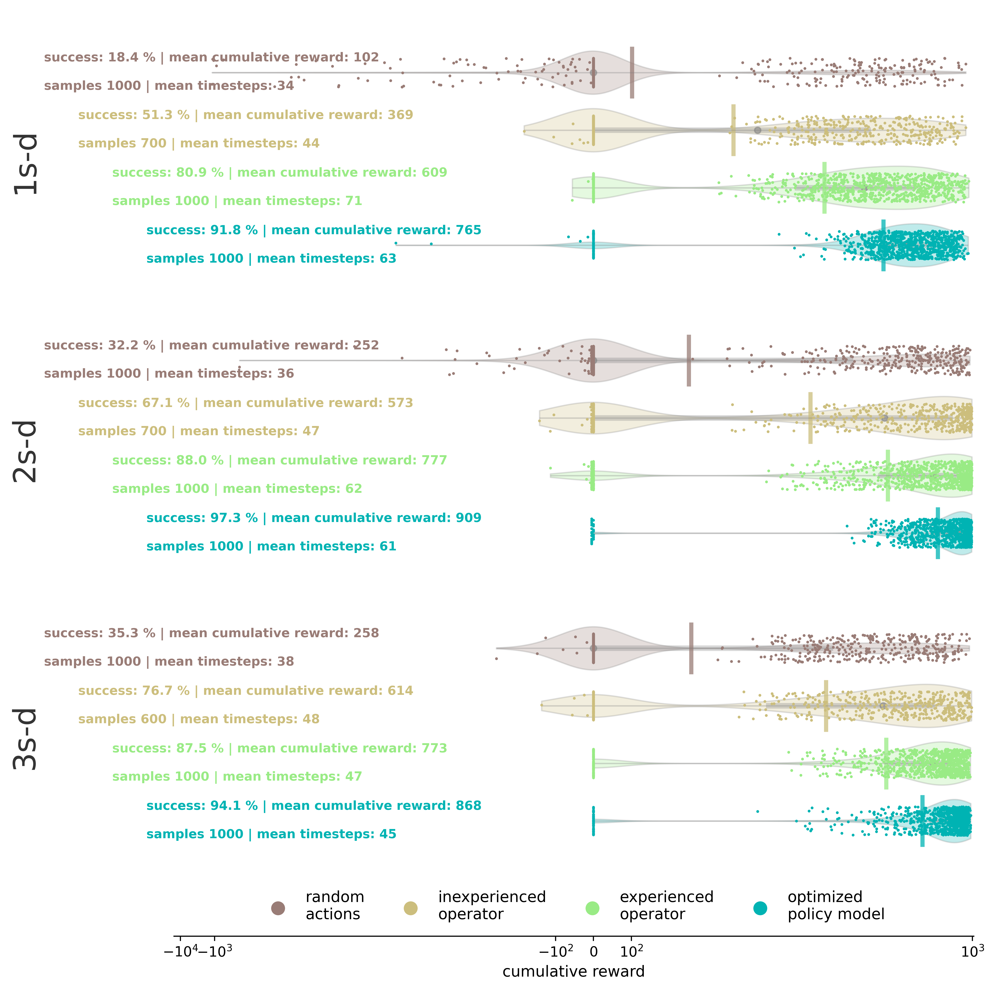

# FloPyArcade

> **Simulated groundwater-flow environments for reinforcement learning.**
> Train and benchmark RL agents on MODFLOW-powered physics — no GPU, no cluster, 16 cores ≈ 1–2 days to beat human operators.


[](https://pypi.org/project/flopyarcade/)
[](https://github.com/philipphoehn/flopyarcade/actions)
[](https://codecov.io/gh/philipphoehn/flopyarcade)
[](https://www.python.org/)
[](LICENSE)
[](https://mybinder.org/v2/gh/philipphoehn/flopyarcade/master)

---

## Table of Contents

- [About](#about)
- [Features](#features)
- [Tech Stack](#tech-stack)
- [Architecture](#architecture)
- [Project Structure](#project-structure)
- [Getting Started](#getting-started)
- [Configuration](#configuration)
- [Benchmarked Environments](#benchmarked-environments)
- [Benchmarks](#benchmarks)
- [3D Visualization](#3d-visualization)
- [Standalone Executables](#standalone-executables)
- [Testing](#testing)
- [Contributing](#contributing)
- [What's Next](#whats-next)
- [Citing](#citing)
- [License](#license)
- [Acknowledgements](#acknowledgements)
- [Author](#author)

---

## About

**FloPyArcade** provides MODFLOW-powered groundwater simulation environments in the [Gymnasium](https://gymnasium.farama.org/) style. It builds on [FloPy](https://github.com/modflowpy/flopy/) to enable pre- and postprocessing of MODFLOW and its related software.

The idea: provide benchmarking environments and examples to the groundwater community for experimenting with reinforcement learning algorithms in search of optimal control strategies.

> 💡 **Why it matters:** What is encapsulated in a game here can be envisioned as real-world operation of an arbitrary groundwater system. You can similarly optimize and test policy models for real-time site operation.

See the [preprint](preprint_FloPyArcade.pdf) for the full technical description.

---

## Features

- **20+ environment types** — discrete and continuous action spaces, multiple well configurations, cost-constrained and multi-objective variants
- **Ray/RLlib integration** — ready-made trainers for APExDQN, PPO, APPO, and IMPALA
- **Classic DQN** — Double Q-learning policy training
- **Neuroevolution** — genetic algorithm with optional novelty search
- **3D visualization** — `pyrender`-based cinematic rendering with camera orbit, glow particles, flow arrows
- **Manual arcade play** — arrow-key control in the simplest environments
- **Standalone executables** — self-contained Linux/Windows/macOS binaries, no Python required
- **Docker support** — containerized deployment with bundled MODFLOW binaries
- **BMI / MODFLOW 6 compliance** — memory-based data exchange (replacing disk I/O)
- **Benchmark suite** — human vs. random vs. trained-network score comparisons

---

## Tech Stack

| Layer | Technology |
|-------|------------|
| Language | Python 3.9 – 3.12 |
| Simulation | MODFLOW 2005, MODFLOW 6, MODPATH 6 |
| Python sim interface | [FloPy](https://github.com/modflowpy/flopy/) ≥ 3.9.2 |
| RL framework | [Gymnasium](https://gymnasium.farama.org/) ≥ 0.29.1 |
| RL training | [Ray / RLlib](https://docs.ray.io/en/stable/ray-rl/index.html) ≥ 2.43.0 |
| Deep learning | [TensorFlow](https://www.tensorflow.org/) ≥ 2.16.0 |
| Rendering | [Pygame](https://www.pygame.org/) 2.1.2, [pyrender](https://github.com/mmatl/pyrender), [Matplotlib](https://matplotlib.org/) |
| Scientific | [NumPy](https://numpy.org/) ≥ 2.1.3, [pandas](https://pandas.pydata.org/) ≥ 2.2.0, [scikit-image](https://scikit-image.org/) ≥ 0.23.0 |
| Packaging | `pyproject.toml` (setuptools), cx_Freeze / PyInstaller for standalone |

---

## Architecture



**Core loop:**
1. Agent selects an action (well rate, well position, or discrete choice).
2. `FloPyEnv` writes the control values into a MODFLOW input file via FloPy.
3. The MODFLOW binary runs (subprocess, ~1–5 s per step).
4. `FloPyEnv` reads heads/fluxes, computes the reward (particle transport score, well capture penalty, head-boundary violation penalty).
5. Returns `(observation, reward, terminated, truncated, info)` to the agent.

---

## Project Structure

```
flopyarcade/                        # CORE — Gymnasium environments
├── flopyarcade.py                  # FloPyEnv (Gymnasium API)
├── env_base.py                     # Environment base class & abstractions
├── env_config.py                   # Env-type parsing, grid setup, well placement
├── agent.py                        # Experimental solvers (DQN, neuroevolution)
├── arcade.py                       # Game loop & scoring
├── play.py                         # Manual / AI-controlled play entry point
├── play3d.py                       # 3D play entry point
├── render.py                       # 2D matplotlib rendering
├── render3d.py                     # 3D pyrender rendering (cinematic theme)
├── reward.py                       # Reward computation
├── observations.py                 # Observation vector assembly
├── actions.py                      # Action space dispatch
├── modflow_runner.py               # MODFLOW 2005 / MP6 subprocess management
├── modpath_runner.py               # MODPATH 6 particle tracking
├── simulators/                     # Bundled MODFLOW / MP6 binaries (per-OS)
├── models/                         # Trained policy checkpoints
├── examples/                       # Training scripts & benchmark assets
│   ├── train_rllib_apexdqn.py      # Ray RLlib APExDQN trainer
│   ├── train_rllib_ppo.py          # Ray RLlib PPO trainer
│   ├── train_rllib_appo.py         # Ray RLlib APPO trainer
│   ├── train_rllib_impala.py       # Ray RLlib IMPALA trainer
│   ├── train_dqn.py                # Classic Double DQN trainer
│   ├── train_neuroevolution.py     # Genetic / novelty-search trainer
│   └── images/                     # GIFs, notebooks, benchmark images
└── tests/                          # pytest suite (fast + slow tiers)
```

---

## Getting Started

### Install

```bash
# Python >= 3.10 (numpy 2.x requirement)
# Environments only (lightweight, ~200 MB):
python -m pip install flopyarcade

# + experimental solvers (Double DQN, neuroevolution):
python -m pip install flopyarcade[solvers]

# + Ray/RLlib benchmarks:
python -m pip install flopyarcade[ray]

# Everything:
python -m pip install flopyarcade[all]

# Linux: also need a Fortran compiler (for MODFLOW binaries)
sudo apt install gfortran
```

### Quick Start

```python
from flopyarcade import FloPyEnv
from numpy.random import choice

env = FloPyEnv(ENVTYPE='3s-d')
reward_total = 0.0

while not env.done:
    action = choice(env.actionSpace)
    obs, reward, *rest = env.step(action)
    reward_total += reward
    env.render()

print(f"Episode reward: {reward_total:.1f}")
env.close()
```

### Play Manually (Arcade Mode)

```bash
python -m flopyarcade.play --manualcontrol True --envtype 3r-d
```

Arrow keys to control. Alt+F4 to quit.

### Train an Agent (Ray/RLlib) — requires `pip install flopyarcade[ray]`

```bash
# APExDQN on 16 cores (~1-2 days to beat human operators)
python flopyarcade/examples/train_rllib_apexdqn.py --envtype 3s-d --cpus 16

# Or PPO, APPO, IMPALA
python flopyarcade/examples/train_rllib_ppo.py --envtype 3s-d --cpus 16
```

### Train with Classic DQN — requires `pip install flopyarcade[solvers]`

```bash
python flopyarcade/examples/train_dqn.py --envtype 3s-d --ngames 20000
```

### Simulate with a Trained Policy

```bash
python flopyarcade/examples/train_rllib_apexdqn.py --playbenchmark True --envtype 3s-d
```

### Render in 3D

```bash
python -m flopyarcade.play3d --envtype 3s-d
```

Dark cinematic theme, camera orbit, glow particles, flow arrows, game HUD.

---

## Configuration

| Parameter | Type | Default | Description |
|-----------|------|---------|-------------|
| `ENVTYPE` | `str` | `'3s-d'` | Environment variant (see table below) |
| `flagRender` | `bool` | `True` | Render 2D matplotlib frames |
| `_seed` | `int` | `None` | Random seed for reproducibility |
| `NAGENTSPARALLEL` | `int` | `1` | Parallel processes for neuroevolution |
| `num_cpus` (Ray) | `int` | auto | CPU cores for distributed training |
| `train_batch_size` (Ray) | `int` | `2000` | RLlib batch size |
| `minibatch_size` (PPO) | `int` | `2000` | Must be ≤ `train_batch_size` |
| `rollout_fragment_length` (PPO) | `int` | `1000` | GAE rollout length |

Environment variables: `PYTHONWARNINGS=ignore::ResourceWarning` recommended for MODFLOW subprocess cleanup.

---

## Benchmarked Environments

| ENVTYPE | Action | Wells | Objective | Human-playable | Benchmark |
|---------|--------|-------|-----------|:---:|:---:|
| `1s-d` | Discrete | 1 fixed | Particle transport | ✅ | ✅ |
| `1r-d` | Discrete | 1 random | Particle transport | ✅ | – |
| `2s-d` | Discrete | 2 fixed | Particle transport | ✅ | ✅ |
| `2r-d` | Discrete | 2 random | Particle transport | ✅ | – |
| `3s-d` | Discrete | 3 fixed | Particle transport | ✅ | ✅ |
| `3r-d` | Discrete | 3 random | Particle transport | ✅ | – |
| `1s-c` / `1r-c` | Continuous | 1 | Multi-well control | – | – |
| `2s-c` / `2r-c` | Continuous | 2 | Multi-well control | – | – |
| `3s-c` / `3r-c` | Continuous | 3 | Multi-well control | – | – |
| `4s-c` / `4r-c` | Continuous | 4 | Multi-well control | – | – |
| `5s-c` / `5s-c-cost` / `5r-c` | Continuous | 5 | Cost-constrained | – | – |
| `6s-c` / `6r-c` | Continuous | 6 | Multi-objective | – | – |
| `0s-d` | Discrete (BMI) | – | Experimental (MODFLOW 6 BMI) | – | – |

**The objective in all transport environments:** Safely transport a virtual particle from the western to the eastern boundary following advection. Protect wells from capture. Keep the particle out of head-boundary cells (north/south). Highest score = shortest route or closest to it.

<details>
<summary>Environment GIFs (16 variants)</summary>

| 1s-d | 2s-d | 3s-d |
|------|------|------|
|  |  |  |

| 1r-d | 2r-d | 3r-d |
|------|------|------|
|  |  |  |

| 1s-c | 2s-c | 3s-c |
|------|------|------|
|  |  |  |

| 1r-c | 2r-c | 3r-c |
|------|------|------|
|  |  |  |

| 4s-c | 4r-c | 5s-c |
|------|------|------|
|  |  |  |

| 5s-c-cost | 5r-c | 6s-c |
|------|------|------|
|  |  |  |

| 6r-c | 0s-d |
|------|------|
|  | (experimental) |

</details>

---

## Benchmarks

Score comparison across four operator types on 1s-d, 2s-d, 3s-d:

1. Random actions
2. Inexperienced human
3. Experienced human
4. Trained deep neural network (policy model)

> The optimized policy model significantly outperforms human control.


| Metric | Image |
|--------|-------|
| Average score evolution |  |
| Operator scores |  |

**Reproduce:**

```bash
python -m flopyarcade.train_rllib_apexdqn --envtype 3s-d --cpus 16
```

**Monitor progress:**

```bash
tensorboard --logdir /path/to/ray/logs
```

**YouTube walkthroughs:**

| 3s-d | 2s-d | 1s-d |
|------|------|------|
| [▶ Watch](https://www.youtube.com/watch?v=LpQ8vY6zn78) | [▶ Watch](https://www.youtube.com/watch?v=VOg-d8rdQH0) | [▶ Watch](https://www.youtube.com/watch?v=eJ0YwvzvvXc) |

---

## 3D Visualization

`render3d.py` and `play3d.py` provide a cinematic 3D rendering pipeline via `pyrender`:

- Dark theme with dramatic lighting
- Glow particles along flow paths
- Comet-style trajectory trail
- 3D well visualization
- Camera orbit (mouse drag)
- Game HUD overlay (score, step, reward)
- Flow arrows on the surface

```bash
python -m flopyarcade.play3d --envtype 3s-d
```


---

## Standalone Executables

Skip the Python install entirely — download a self-contained binary:

### Linux x86-64

```bash
# From GitHub Releases
wget https://github.com/philipphoehn/flopyarcade/releases/download/latest/FloPyArcadePlay
chmod +x FloPyArcadePlay
./FloPyArcadePlay
```

Runs headless or with display (auto-detects). No Python, pip, or system dependencies required.

### Windows

Download pre-built EXEs from [GitHub Releases](https://github.com/philipphoehn/flopyarcade/releases):

- `FloPyArcadePlay.exe` (ENV 1s-d / 2s-d / 3s-d variants)

### macOS

Built via PyInstaller. See [`build-branch/`](build-branch/) for the build workflow.

---

## Testing

```bash
# Fast suite (CI, ~30 s)
pytest flopyarcade/tests/ -m "not slow" -v --timeout=1800

# Full suite including Ray integration (~2 min)
pytest flopyarcade/tests/ -v --timeout=3000

# Single file
pytest flopyarcade/tests/test_rllib_cpu.py -v
```

| Tier | Markers | Time | Coverage |
|------|---------|------|----------|
| Fast | default | ~30 s | Unit, mock RLlib, render3d, regression |
| Slow | `@pytest.mark.slow` | ~2 min | Real Ray/RLlib 1-iteration training (DQN, PPO, APPO, IMPALA) |

---

## Contributing

Pull requests and constructive discussions are welcome.

**Flow:**
1. Fork → create a branch from `master`
2. Make your changes
3. Run the test suite: `pytest flopyarcade/tests/ -m "not slow"`
4. Open a Pull Request
5. For major changes, open an issue first to discuss

**Guidelines:**
- PEP-8 compliant (recommended, not strictly enforced)
- All new features require tests
- No breaking changes to the Gymnasium API surface without discussion
- Keep the `ENVTYPE` string contract stable (downstream scripts depend on it)

---

## What's Next

See [ROADMAP.md](ROADMAP.md) for the full prioritized backlog. Highlights:

- [ ] MODFLOW 6 BMI: in-memory data exchange (eliminate disk I/O)
- [ ] Distributed training on GPU clusters via Ray
- [ ] Continuous-action benchmarks (PPO / SAC)
- [ ] Multi-aquifer / 3D environment types
- [ ] Web-based playground (Browser WASM)
- [ ] Agent benchmark leaderboard API

---

## Citing

```bibtex
@misc{FloPyArcade,
  author       = {Hoehn, Philipp},
  title        = {FloPyArcade: Simulated groundwater environments for reinforcement learning},
  year         = {2020},
  publisher    = {GitHub},
  howpublished = {\url{https://github.com/philipphoehn/flopyarcade}},
}
```

Preprint: [preprint_FloPyArcade.pdf](preprint_FloPyArcade.pdf)

---

## License

[GNU GPLv3](LICENSE)

---

## Acknowledgements

- [FloPy](https://github.com/modflowpy/flopy/) — MODFLOW Python interface
- [MODFLOW](https://www.usgs.gov/mission-areas/water-resources/science/modflow-and-related-programs) — USGS groundwater flow models
- [Ray / RLlib](https://docs.ray.io/) — distributed RL framework
- [Gymnasium](https://gymnasium.farama.org/) — RL environment standard
- [TensorFlow](https://www.tensorflow.org/) / [Keras](https://keras.io/) — deep learning
- [NumPy](https://numpy.org/) — scientific computing
- [Pygame](https://www.pygame.org/) — 2D rendering
- [pyrender](https://github.com/mmatl/pyrender) — 3D rendering
- [pythonprogramming.net](https://pythonprogramming.net/) & [sentdex](https://www.youtube.com/user/sentdex) — RL tutorials

---

## Author

**Philipp Hoehn**

- 📧 [philipp.hoehn@yahoo.com](mailto:philipp.hoehn@yahoo.com)
- 🎓 [philipp.hoehn@univie.ac.at](mailto:philipp.hoehn@univie.ac.at)
- 🔗 [GitHub](https://github.com/philipphoehn)

---

*FloPyArcade prioritises functional correctness and benchmark reproducibility. The core loop is intentionally minimal to stay transparent and easy to extend. Developed in spare time — contributions are what make it better.*
